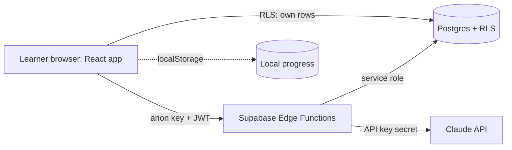

# Architecture

## Data flow: Explain
1. Client calls `explain` with topic, language, level.
2. Function checks `explanations` cache. Hit: return it (no AI cost).
3. Miss: rate-limit check, call Claude, Zod-validate (retry once), store, return.

## Data flow: Quiz
1. Client calls `generate-quiz` with topic ids and count (5 or 10).
2. Function asks Claude for questions per topic, validates with Zod and quality gates, inserts into `questions`, returns them with ids.
3. On AI failure or rate limit, it serves unflagged questions from the bank.
4. Each answer is saved locally (attempt + Leitner box) and to Supabase when signed in.

## Key decisions
- **AI is server-side only:** the API key must never reach the browser bundle.
- **Cache explanations, bank questions:** lower cost and latency, works when AI is slow or down.
- **Pure logic in `src/lib`:** spaced repetition and readiness are unit-tested without React.
- **localStorage first:** guests and low-bandwidth learners work immediately; cloud is additive.
- **Clients cannot edit content:** public tables are read-only; only `flag_question()` can flag.
