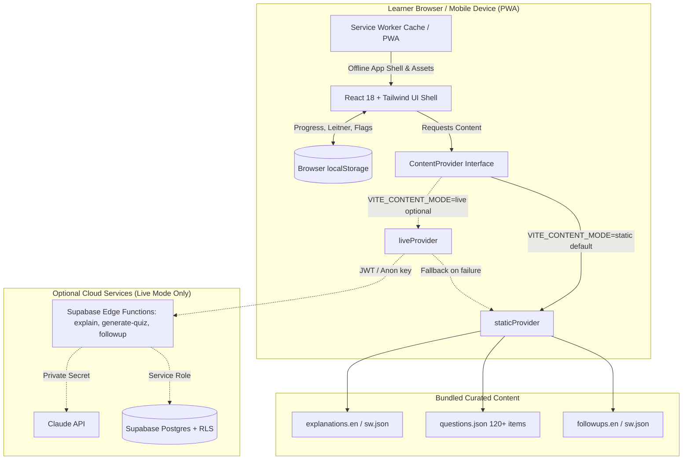

# Architecture & Data Flow: Mwalimu Cloud

**Mwalimu Cloud** is designed with a **Curated-First, Offline-Ready** architecture. By default, the application runs with zero backend dependencies (`VITE_CONTENT_MODE=static`), bundling human-reviewed explanations, question banks, and follow-up chips. An optional live mode (`VITE_CONTENT_MODE=live`) integrates with Supabase Edge Functions and Claude for dynamic generation.

---

## 1. System Architecture Diagram



---

## 2. The ContentProvider Pattern

To guarantee that the UI remains decoupled from data sourcing, all views interact exclusively through the abstract `ContentProvider` interface:

```typescript
export interface ContentProvider {
  getExplanation(topicId: string, language: string, level: 'standard' | 'simpler'): Promise<Explanation>
  getQuiz(topicIds: string[], count: 5 | 10, language: string): Promise<{ questions: Question[]; notice?: string }>
  getFollowups(topicId: string, language: string): Promise<FollowupQA[]>
  askLiveFollowup?(topicId: string, question: string, language: string): Promise<{ on_topic: boolean; answer: string }>
}
```

### Static Mode (`staticProvider`) – Default
- **Explanations:** Loaded directly from pre-compiled JSON files (`src/content/explanations.*.json`) in $O(1)$ time.
- **Quizzes:** Samples 5 or 10 questions without repeats within a session from the 120+ question curated bank. Dynamically shuffles option positions (A, B, C, D) while maintaining accurate answer and explanation mappings.
- **Follow-ups:** Serves 4 curated Q&A chips per topic that expand on tap.
- **Network calls:** Exactly 0.
- **Offline operation:** 100% functional via Service Worker cache.

### Live Mode (`liveProvider`) – Optional
- **Explanations & Quizzes:** Calls Supabase Edge Functions (`explain`, `generate-quiz`).
- **Follow-ups:** Free-text interactive chat evaluated by Claude with prompt-injection defense and topic lock.
- **Graceful Fallback:** If the network or Edge Functions fail, `liveProvider` automatically falls back to `staticProvider`.

---

## 3. Data Flows

### A. Explain Mode
1. `useQuery` calls `getExplanation(topicId, language, level)`.
2. In static mode, returns the structured explanation card (simple explanation, official definition, African analogy, analogy limits, key terms, exam tip, common mistake).
3. Follow-up section loads curated chips (`getFollowups`) in static mode or live chat (`askLiveFollowup`) in live mode.

### B. Quiz & Spaced Repetition (Leitner 5-Box)
1. User selects a topic or "Mixed (weak areas first)" with 5 or 10 questions.
2. Questions are sampled without repeats in that session and option positions are shuffled.
3. Upon submission:
   - Evaluates correct answer.
   - Updates Leitner review state:
     $$\text{Next Box} = \begin{cases} \min(\text{Box} + 1, 5), & \text{if correct} \\ 1, & \text{if wrong} \end{cases}$$
   - Review intervals: Box 1 (0 days, due immediately), Box 2 (1 day), Box 3 (3 days), Box 4 (7 days), Box 5 (14 days).
   - Saves attempt and updated review state to `localStorage`.
   - If signed in and in live mode, syncs attempt and state to Supabase Postgres.

### C. Readiness Engine
1. Reads the last 20 attempts per topic (`RECENT_WINDOW = 20`).
2. Calculates accuracy per topic and marks status:
   - `not_started`: 0 attempts.
   - `learning`: 1–4 attempts, or accuracy $< 75\%$.
   - `strong`: $\ge 5$ attempts AND accuracy $\ge 75\%$.
3. Calculates domain scores as the mean accuracy across all domain topics.
4. Computes overall score weighted by official AZ-900 domain weights:
   $$\text{Overall Score} = \sum (\text{Domain Weight} \times \text{Domain Score})$$
5. Assigns readiness label: $<50\%$ "Keep building", $50-74\%$ "Getting there", $75-84\%$ "Almost ready", $85\%+$ "Exam ready".

### D. Study Planner (`/planner`)
1. Inputs: Target exam date, daily available hours (0.5h – 4h), and current weak topics.
2. Clamps study window between 3 and 45 days.
3. Sorts topics by priority:
   - Weakest attempted topics first ($< 75\%$ accuracy).
   - Unattempted topics weighted by domain weight.
4. Generates daily itineraries composed of Revision, Focused Explanation, and Practice Quizzes.

### E. Progress Backup & Restore (Latest Timestamp Wins)
- **Export:** Serializes attempts and Leitner states into a JSON file (`progressExportSchema`).
- **Import:** Validates JSON schema with Zod.
- **Merge Strategy:** Deduplicates attempts by `(questionId, at)` and resolves review state conflicts using the greatest `lastReviewedAt` timestamp.
