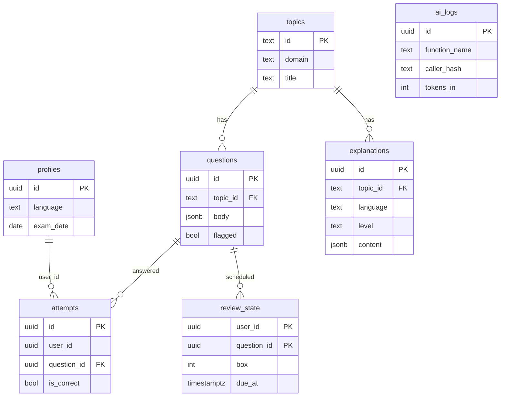

# Database

## RLS summary
| Table | Clients can |
|---|---|
| profiles, attempts, review_state | read/write only their own rows |
| topics, explanations | read only |
| questions | read only, and only unflagged rows; flag via `flag_question()` |
| ai_logs | nothing (RLS on, no policies; service role only) |

Writes to topics, explanations and questions happen in Edge Functions with the service role. `ai_logs.caller_hash` is a salted hash, never a raw id or IP.
